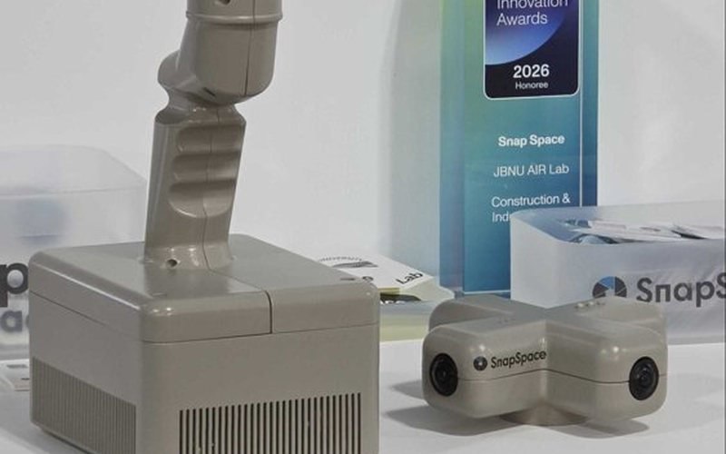
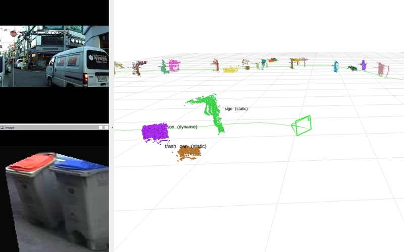
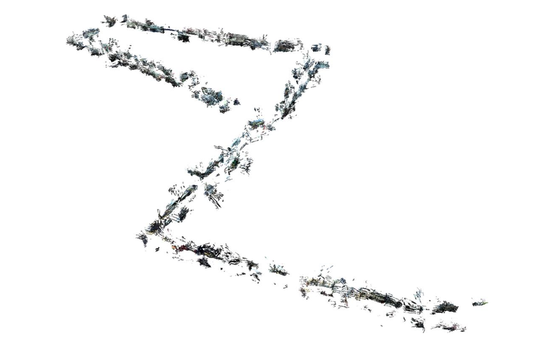
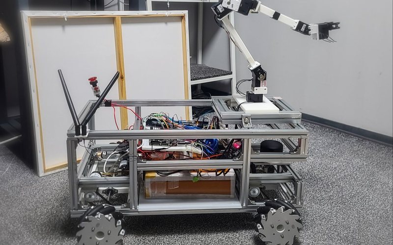
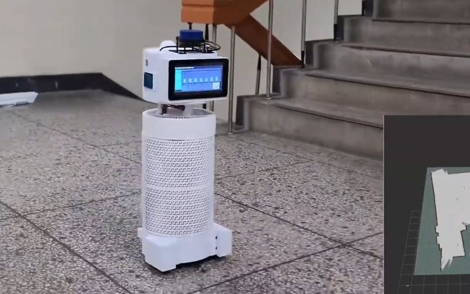

<!-- ===================== HEADER ===================== -->

  

  

  
  
  

## 👋 About

I'm a robotics software engineer bringing **robot manipulators to real manufacturing sites**.
Before that, I built perception and localization software (**Visual / Visual-Inertial SLAM**, **multi-sensor calibration**,
**semantic & object mapping**), from designing the hardware to deploying the algorithms on real robots.

### 🔭 Currently
- 🏭 Applying **manipulators to manufacturing processes** at GlobalDefense
- 🧪 Building simulation environments in **NVIDIA Isaac Sim**
- 🧠 Training manipulator policies with **reinforcement learning** for sim-to-real deployment

### ✨ Highlights

- 🏆 Co-developed a multi-camera SLAM device recognized as a **CES 2026 Innovation Awards Honoree** (Construction & Industrial Tech)
- 🤖 Background in **Mechanical + Electronic Engineering**, so I'm comfortable with both CAD and C++

## 🛠 Tech Stack

  

  
  
  
  
  

| Area | Details |
|:--|:--|
| **Manipulation** | Manipulator control · Reinforcement learning · Isaac Sim environment design |
| **SLAM** | Visual SLAM · Object SLAM · Semantic SLAM · Visual-Inertial SLAM · Multi-camera SLAM |
| **Calibration** | Camera–Camera · Camera–IMU · LiDAR–Camera |
| **Hardware** | Mechanical design & modeling · 3D printing · Sensor rig design |

## 🚀 Featured Projects

<table>
  <tr>
    <td width="50%" align="center">
      
       <b>Multi-camera Lightweight SLAM Device</b>
       Low-power multi-camera + IMU mapping device 🏆 CES 2026 Innovation Awards · 2025–2026
    </td>
    <td width="50%" align="center">
      
       <b>VLM-based Zero-shot Object Mapping</b>
       Maps unknown objects without pre-training, using a server-side VLM 2025
    </td>
  </tr>
  <tr>
    <td width="50%" align="center">
      
       <b>Outdoor Navigation for Last-mile Delivery</b>
       GNSS-Visual-Inertial localization and door & building contour mapping 2024–2025
    </td>
    <td width="50%" align="center">
      
       <b>Omnidirectional Mobile Manipulator</b>
       Mecanum-wheel base + 6-DOF arm for smart-farm harvesting 🥉 Capstone Design Contest · 2023
    </td>
  </tr>
  <tr>
    <td colspan="2" align="center">
      
       <b>PuryBot: AI Autonomous Air Purifier</b>
       Air purifier that learns polluted areas and drives there with ROS 2 🥈 Hanium ICT Contest · 2022
    </td>
  </tr>
</table>

## 💼 Experience

- **2026 – Present** | GlobalDefense — Robotics Software Engineer
  - Manipulator applications for manufacturing · Isaac Sim environments · RL-based manipulator training
- **2023 – 2026** | AI Robotics Lab (AIR Lab), Jeonbuk National University — Graduate Research Assistant
- **2022 – 2023** | DRoC Lab, Jeonbuk National University — Undergraduate Research Intern

## 🎓 Education

- **2024 – 2026** | Jeonbuk National University — M.S. in Electronic Engineering
- **2017 – 2024** | Jeonbuk National University — B.S. in Mechanical Engineering
  - Interdisciplinary Major in Future Automotive Engineering (2023 – 2024)

## 🏆 Awards

| Year | Award | Project |
|:--:|:--|:--|
| 2026 | **CES Innovation Awards Honoree** — Construction & Industrial Tech | Multi-camera Lightweight SLAM Device |
| 2023 | **Grand Prize** — JBNU Self-Design Contest (President's Award) | 4-DOF Cooperative Robot |
| 2023 | **Bronze Prize** — JBNU Capstone Design Contest | Omnidirectional Mobile Manipulator for Tomato Harvesting |
| 2022 | **Silver Prize** — Hanium ICT Mentoring Contest (IITP President's Award) | PuryBot: AI Autonomous Air Purifier |

  

